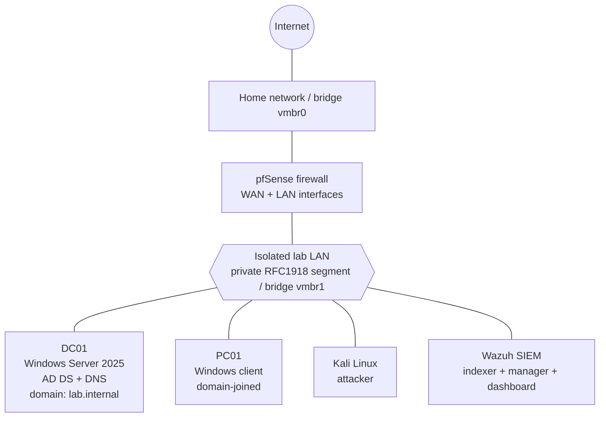

# Active Directory Attack and Detection Home Lab

A self-built, fully isolated lab where I stand up a Windows Active Directory domain, compromise it end to end using standard red-team tradecraft, and then detect the same attack from the blue-team side with a SIEM. The goal was to understand both how an AD environment is attacked and how a defender sees it, using the same open tooling a small SOC or infrastructure team would run.

**What this project demonstrates in one line:** I escalated from an unprivileged service account to Domain Admin, then caught that exact escalation in Wazuh as a high-severity alert mapped to MITRE ATT&CK, and remediated it.

---

## Skills demonstrated

- **Virtualization and infrastructure:** Proxmox VE, VM lifecycle, virtual networking (Linux bridges)
- **Network security:** pfSense firewall, network segmentation, isolated lab LAN
- **Windows administration:** Windows Server 2025, Active Directory Domain Services, DNS, Group Policy, service accounts, OU and group design
- **Offensive security:** reconnaissance, enumeration, password spraying, Kerberoasting, hash cracking, Active Directory ACL abuse, privilege escalation
- **Tooling:** nmap, NetExec, Kerbrute, Hashcat, BloodHound, SharpHound, Kali Linux
- **Blue team and SIEM:** Wazuh (indexer, manager, dashboard), agent deployment, Windows event collection, alert triage, MITRE ATT&CK mapping
- **Operations:** Linux administration, LVM, troubleshooting under real failure conditions, documentation

---

## Lab architecture

All VMs run on a single Proxmox host. pfSense sits between my home network and an isolated lab LAN, so the vulnerable domain is never exposed to the internet or the rest of my home. Every lab machine lives on a private bridge with no physical port of its own.



| Host | Role | OS |
|------|------|----|
| pfSense | Firewall and router between home network and lab LAN | pfSense CE |
| DC01 | Domain Controller, DNS, forest root of `lab.internal` | Windows Server 2025 |
| PC01 | Domain-joined workstation, attacker foothold | Windows client |
| Kali | Attack platform | Kali Linux |
| Wazuh | SIEM: log collection, detection, dashboards | Ubuntu Server |

> Screenshot to add here: the Proxmox VM list showing all the lab VMs.

**Why it is built this way:** the domain is deliberately placed behind pfSense on a bridge with no uplink, so I can run live attacks and malware-adjacent tooling without any risk to my home network. The firewall also gives me a single controlled point for later network-monitoring work.

---

## Part 1: Offensive, compromising the domain

The attack follows the path a real intruder takes after gaining a first foothold on the network: find the hosts, enumerate the domain, grab a crackable credential, map the privilege relationships, then abuse one to become Domain Admin.

### 1. Reconnaissance

Scanned the lab subnet from Kali to find live hosts and identify the Domain Controller by its open services (DNS 53, Kerberos 88, LDAP 389, SMB 445).

```bash
nmap -sC -sV -p- <DC-host>
```

> Screenshot to add: the nmap output showing DC ports.

### 2. Enumeration

Used NetExec and Kerbrute against the DC to confirm the domain, validate users, and check SMB.

```bash
netexec smb <DC-host>
kerbrute userenum -d lab.internal --dc <DC-host> users.txt
```

### 3. Password spraying

Sprayed a weak candidate password across the enumerated users to find a valid low-privilege account (the service account `svc-sql`), without locking accounts out.

```bash
netexec smb <DC-host> -u users.txt -p 'Season2026' --continue-on-success
```

### 4. Kerberoasting

With one valid domain credential, requested Kerberos service tickets (TGS) for accounts that have a Service Principal Name, which returns a ticket encrypted with the service account's password hash.

```bash
netexec ldap <DC-host> -u svc-sql -p 'Season2026' --kerberoasting kerb_hashes.txt
```

**Depth note:** Windows Server 2025 disables RC4 by default, so the tickets came back as AES, not the older RC4 format most tutorials assume. That changed which Hashcat mode I needed and is a good example of modern defaults breaking an old playbook.

### 5. Cracking the hash

Cracked the AES Kerberos hash offline with Hashcat (mode 19700 for AES-256 TGS-REP).

```bash
hashcat -m 19700 kerb_hashes.txt rockyou.txt
```

> Screenshot to add: Hashcat showing the recovered password (redact the password itself).

### 6. Mapping the attack path with BloodHound

Collected the domain's users, groups, sessions, and ACLs with SharpHound, then loaded the data into BloodHound to visualize privilege relationships. BloodHound surfaced a path: `svc-sql` held a `GenericAll` right that could be abused to reach **Domain Admins**.

```bash
# SharpHound run (scoped to the domain, authenticated as the cracked account)
SharpHound.exe -c All -d lab.internal --ldapusername svc-sql --ldappassword 'REDACTED' --domaincontroller dc01.lab.internal
```

> Screenshot to add: the BloodHound graph showing the svc-sql to Domain Admins path.

**Depth note:** the Linux-based collectors failed against the DC because Server 2025 enforces LDAP signing and channel binding by default. Running SharpHound from a domain-joined Windows host was the realistic way around it, which itself is a useful lesson about how modern AD hardening pushes attackers toward on-host collection.

### 7. Privilege escalation: abusing GenericAll

`GenericAll` over the Domain Admins object means full control, including the right to add a member. I granted the right (simulating the discovered misconfiguration) and used it to add `svc-sql` to Domain Admins.

```cmd
:: grant the GenericAll right on the Domain Admins object (the misconfiguration)
dsacls "CN=Domain Admins,CN=Users,DC=lab,DC=internal" /G "lab\svc-sql:GA"

:: abuse it: add the service account to Domain Admins
net group "Domain Admins" svc-sql /add /domain
```

At this point an unprivileged service account is a Domain Admin. Full domain compromise.

**Depth note:** the first abuse attempt failed with Access Denied, because Active Directory's AdminSDHolder and SDProp process had automatically reverted my ACL change on the protected group within the hour. Re-granting the right and immediately abusing it worked. This is a real AD security mechanism most people never see, and understanding it matters for both attack and defense.

---

## Part 2: Defensive, detecting the attack with Wazuh

The same actions a defender would need to catch. I deployed a Wazuh agent to the Domain Controller, replayed the privilege escalation, and watched it surface as an alert.

### Agent deployment

Installed the Wazuh agent on DC01 pointed at the Wazuh manager, so Windows Security events flow into the SIEM.

```powershell
Invoke-WebRequest -Uri https://packages.wazuh.com/4.x/windows/wazuh-agent-4.14.0-1.msi -OutFile wazuh-agent.msi
msiexec.exe /i wazuh-agent.msi /q WAZUH_MANAGER='<wazuh-host>'
NET START Wazuh
```

> Screenshot to add: the Wazuh Endpoints page showing DC01 as Active.

### The detection

Replaying the Domain Admins change generated Windows Security **event 4728** ("a member was added to a security-enabled global group"). The agent shipped it to Wazuh, which matched it to rule **60159** and raised a **Level 12** (high severity) alert.

> Screenshot to add: the Wazuh alert document for event 4728.

Key fields from the alert, which together prove the detection:

| Field | Value |
|-------|-------|
| rule.description | Domain Admins Group Changed |
| rule.level | 12 |
| rule.id | 60159 |
| data.win.eventdata.subjectUserName | Administrator (who made the change) |
| data.win.eventdata.memberName | CN=svc-sql,... (who was added) |
| data.win.eventdata.targetUserName | Domain Admins (the group) |
| rule.mitre.id | T1484 |
| rule.mitre.tactic | Defense Evasion, Privilege Escalation |

The valuable part is the last two rows: Wazuh automatically mapped the activity to a real MITRE ATT&CK technique, which is exactly how a SOC analyst pivots from a raw log to understanding adversary intent.

### Remediation

Removed the account from the privileged group and recorded the rollback, which itself generated a second 4728 (a removal) in the SIEM, so the full change cycle is on record.

```cmd
net group "Domain Admins" svc-sql /delete /domain
```

**Hardening takeaways:**
- Service accounts should never hold writable ACLs over privileged groups. Audit `GenericAll`, `WriteDacl`, and `GenericWrite` on tier-0 objects with BloodHound on a schedule.
- Enforce strong, long service-account passwords (or move to Group Managed Service Accounts) to defeat Kerberoasting.
- Alert on changes to protected groups (event 4728 / 4732) at high severity, which this lab proves Wazuh does out of the box.
- Keep LDAP signing and channel binding enforced; they already blocked the remote collectors here.

---

## Attack to detection mapping (MITRE ATT&CK)

| Attack step | Technique | ATT&CK ID | Visibility in this lab |
|-------------|-----------|-----------|------------------------|
| Password spraying | Brute Force: Password Spraying | T1110.003 | Windows logon events |
| Kerberoasting | Steal or Forge Kerberos Tickets: Kerberoasting | T1558.003 | Kerberos service-ticket requests (deeper coverage planned with Sysmon) |
| BloodHound enumeration | Account and Permission Groups Discovery | T1087 / T1069 | LDAP queries |
| Add to Domain Admins | Domain Policy Modification | T1484 | **Detected: Wazuh rule 60159, Level 12** |

---

## Troubleshooting and lessons learned

The parts that broke taught me the most, and they are the closest thing in the lab to real operations work:

- **Wazuh install hung at "Updating the internal users."** I first chased RAM and CPU, but the real cause was a full disk: Ubuntu's default LVM only allocated about half the volume group to root. Fixed it by extending the logical volume (`lvextend` then `resize2fs`) and the install completed. Lesson: check the obvious resource (disk) before theorizing.
- **AdminSDHolder reverted my ACL.** My GenericAll grant on Domain Admins silently disappeared within the hour. Learning that SDProp protects privileged groups explained the Access Denied error and changed my timing.
- **LDAP signing and channel binding blocked the Linux collectors.** Server 2025 hardening pushed me to run SharpHound from a domain-joined Windows host, which is how it is done against a hardened domain.
- **Windows Defender kept deleting SharpHound.** A good reminder that endpoint protection is part of the threat model, and why attackers disable or evade it.
- **RC4 is off by default on Server 2025**, so Kerberoasting produced AES tickets and required a different Hashcat mode.
- **Proxmox host kernel crashes (i915 driver)** made the box unreachable after boot until I blacklisted the module and pinned a CPU idle state. Real headless-server debugging.

---

## Limitations and next steps

This is a single-Domain-Controller lab with no live user traffic, so detections are not yet tuned at production scale and some attacks (like Kerberoasting) are not yet surfaced as alerts. I am building on it in that order:

1. **Detection engineering:** add Sysmon to the Windows hosts, run Atomic Red Team, and write and tune custom Wazuh rules.
2. **Network monitoring:** enable Suricata IDS on pfSense and correlate network alerts with host telemetry.
3. **Cloud SOC:** rebuild a slice of this in Azure with Microsoft Sentinel and KQL analytics.

(Full roadmap in my notes, covering infra monitoring, EDR, and Zero Trust as well.)

---

## A note on sanitization

This is a lab on an isolated private network. Specific IP addresses and the admin password have been removed or replaced with placeholders (`<DC-host>`, `<wazuh-host>`, `REDACTED`). Hostnames and the lab domain name are invented and carry no sensitive information.
